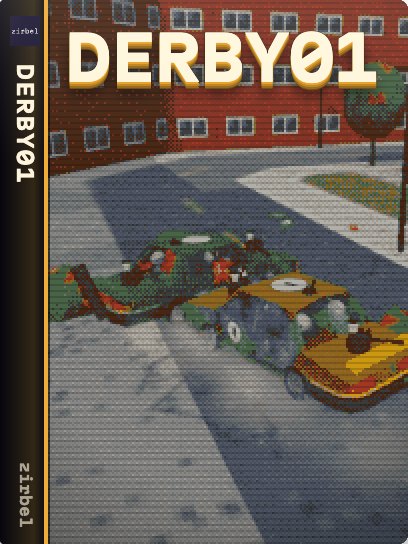

# derby01



A browser paintball demolition derby. Pick a driver, mechanic or gunner seat; bots fill the rest.
Play locally or join a Zirbel host.

## Run

Use Node.js 24 or newer and npm.

```sh
npm ci --ignore-scripts
npm run dev                # http://localhost:8411; PORT changes the port
```

`npm run build` creates `dist/web`; `npm run zirbel` creates `dist/zirbel/derby01`.
Serve either build over HTTP. The root HTML is a build source.

## Develop

```sh
npm run verify             # formatting, types, tests and both builds
npm run format             # format maintained files
```

Tune rules in `data/` and update schemas alongside changes. Read [AGENTS.md](AGENTS.md) first.
Browser and network scenarios under `test/live/` require a running game and local Zirbel hub.

## Docs

- [Architecture](docs/architecture.md): ownership and compatibility contracts.
- [Gameplay](docs/gameplay.md): controls, seats, radio and round reports.
- [Shared standard](docs/engineering/STANDARD.md): language and tooling.
- [Contributing](CONTRIBUTING.md) and [security reports](SECURITY.md).
- [Public repository source and publication prerequisites](docs/PUBLIC_REPOSITORY.md).

## License

Code: [MIT](LICENSE). Third-party work keeps its own license and visible front-cover credits.
Car: Bricchi Games, CC BY 4.0 ([source, changes and license](assets/car/LICENSE.txt)).
Fonts: Bungee and Barlow Condensed, SIL OFL 1.1 (`assets/fonts`).
Audio: fabianofa, CC0; optional reviewed CC0 music (`assets/audio`). three.js is MIT.
See the [asset licence audit](docs/ASSET_LICENSE_AUDIT.md) for licence scope and retained notices.
